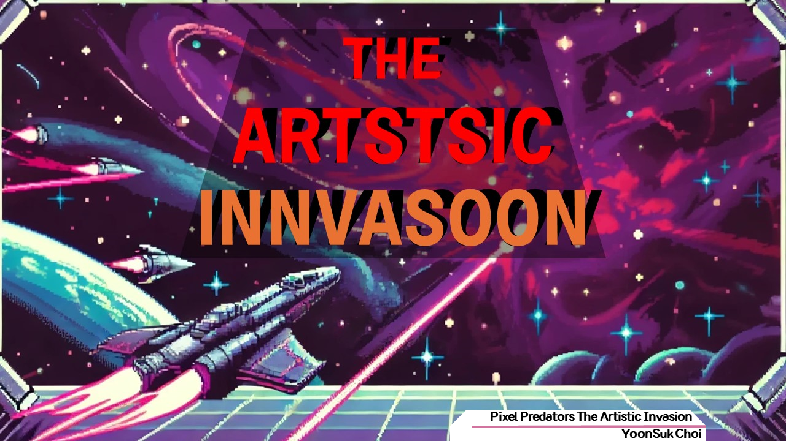
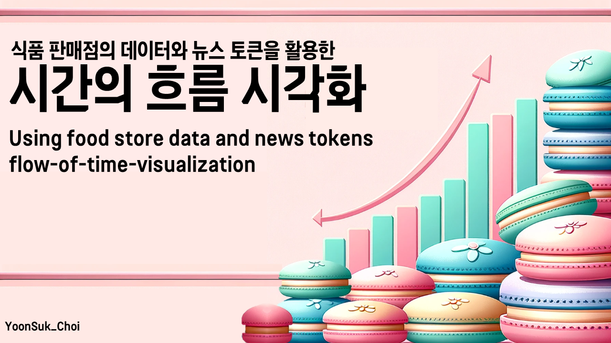

## - 👨🏻‍🎓  Welcome to choi’s GitHub
* Name : 최윤석(YoonSuk Choi)
* 안녕하세요. 경영학과를 졸업했고, 데이터 기획과 분석을 공부하고 있습니다.
* AI 교육
* 

## - ⚡ 언어 및 도구
| 분류      | 목록      |
| :---      | :---    |
| 관리도구 |   |
| 개발 환경 및 툴 |        |
| 프로그래밍 언어 데이터 처리 |       |
| 데이터베이스 |      |
| 클라우드 서비스 |      |
| 웹 개발 |      |
| 오피스 환경 |       |

## - 🌱 교육
* Korea Business News TV
  - IT융합 스마트 콘텐츠 (2017.09.01~ 2018.02.28)
* 새싹 SeSAC(Seoul Software Academy)
  - 데이터 분석가 과정 (2023.08.28~ 2023.12.01)
* 새싹 SeSAC(Seoul Software Academy)
  - 웹 프론트엔드, 백엔드 풀스텍 과정 (2024.10.23~ 2025.01.13)
 
## - 👍 근무
* 대방연세재활의학과 원무과 근무
  - 데이터 수집, 분석 마케팅 (2021.12.31~ 2023.02.28)

## - 📷 portfolio

  

